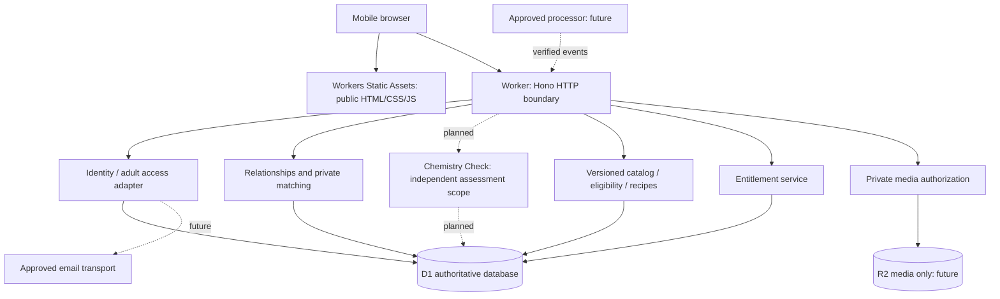
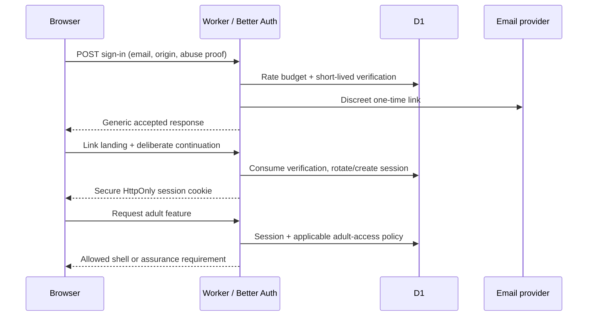
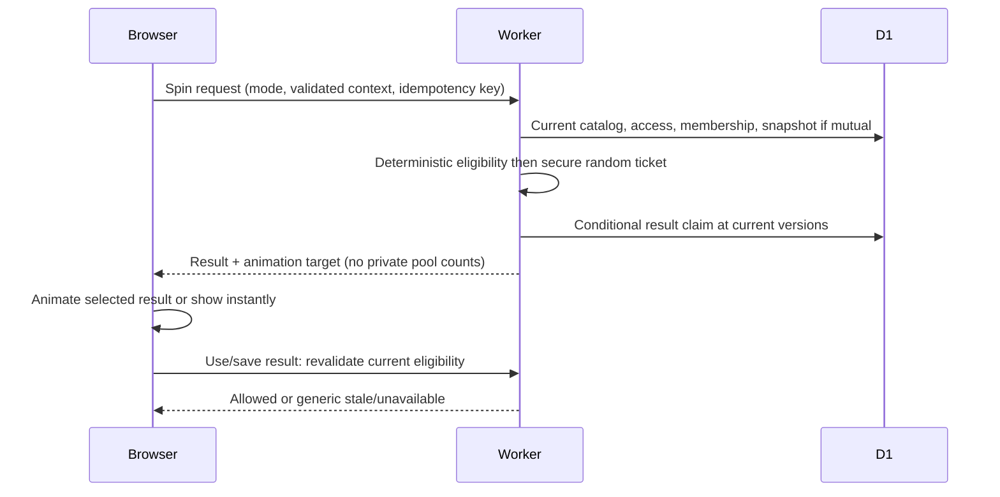
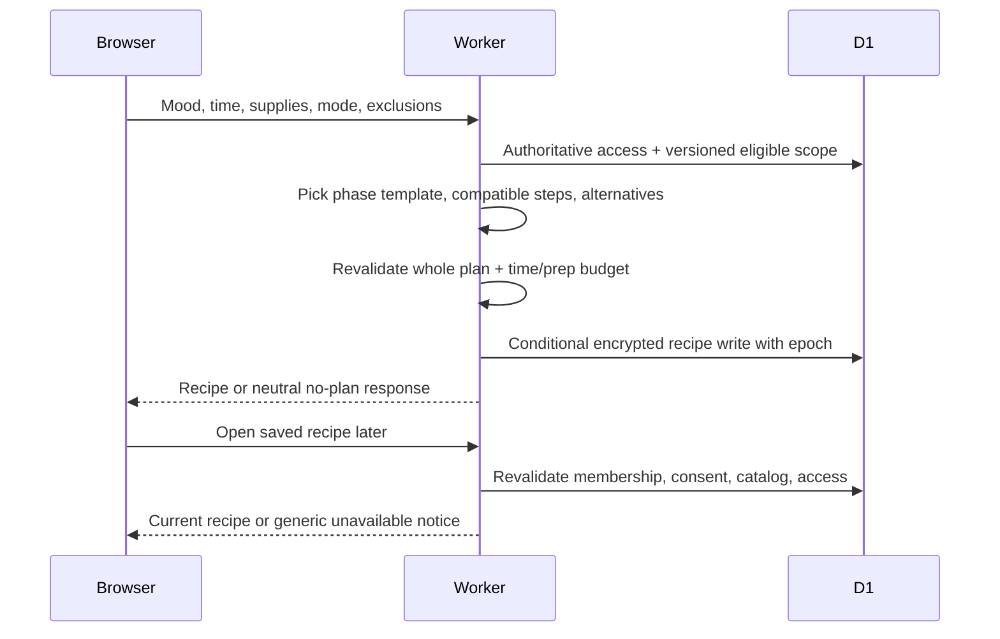
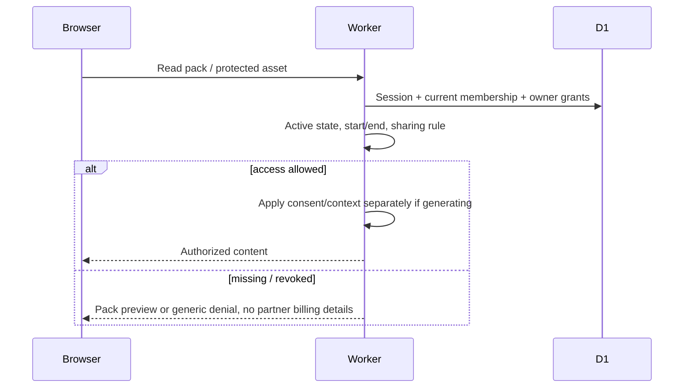

# Application architecture

## M3A implementation update

The same modular Worker now mounts a reviewed account/auth router alongside the guest wheel. Better Auth 1.7.27 uses its native D1 adapter; the proposed Drizzle layer is unnecessary. Cloudflare Email Sending provides the fixed accounts sender through a restricted native binding. Auth schema generation and compiled workerd/D1 checks are part of npm run check. [AUTH.md](AUTH.md) and [ADR 0010](DECISIONS/0010-m3a-identity-and-adult-access.md) supersede earlier disabled-auth statements. Independent access tiers default closed; no private matching, age-provider dependency or extra deployed Worker was added.

Status: accepted foundation stack; production auth, age assurance and commerce integrations remain gated. Sources checked 2026-11-19.

**M2 update, 2026-11-20:** the first playable Wheel of Misfortune (guest Discovery Mode) is
implemented and released. A typed editorial catalog (`src/content/discovery/catalog.ts`) is
validated and compiled into idempotent seeds by `scripts/build-seeds.ts`; D1 remains the read
authority and is reloaded per request with no authorization cache. `src/domain/wheel.ts` holds the
pure request contract, eligibility mapping, weighted selection and shortlist construction;
`src/services/wheel.ts` owns catalog/guest persistence; `src/server/wheel.ts` is the HTTP boundary
mounted at `/api/v1`. The client is a small Preact module tree under `src/client/wheel/`. Guest state
is a client-proposed nonce with a 24h TTL (migration `0002`), never a cookie, and no boundary values
are stored. See [Wheel](WHEEL.md) for the contract and [ADR 0007](DECISIONS/0007-m2-guest-wheel.md).

**Production integration update, 2026-11-20:** the user authorized public deployment. The safe public release configuration is implemented with explicit local/production bindings, Worker-first asset handling, canonical redirects, initial-HTML metadata and a public-only CFLab adapter. Private auth/assessment/activity/payment functionality is still gated. See [Deployment](DEPLOYMENT.md) and [launch report](LAUNCH_REPORT.md) for actual operational state; earlier local-only statements below describe the initial stage.

## Stack decision

| Option                         | Advantages                                                                                  | Costs / decision                                                                                                 |
| ------------------------------ | ------------------------------------------------------------------------------------------- | ---------------------------------------------------------------------------------------------------------------- |
| Vanilla TypeScript + Vite      | Smallest runtime, web-native                                                                | Manual state/focus/form coordination gets costly for private decks and wheel controls; viable for marketing only |
| Preact + Vite + Hono           | Small component runtime, standard Fetch API, independent domain code, static marketing HTML | Explicit routing/build boundaries; selected for scope and low operational complexity                             |
| SvelteKit + Cloudflare adapter | Cohesive SSR, forms and routing; official adapter                                           | Strong alternative if editorial/SSR needs grow; adds framework-specific server conventions now                   |
| React/Next.js                  | Large ecosystem                                                                             | No requirement justifies their extra framework/runtime surface for this product; not the default                 |

[Preact recommends Vite for setup](https://preactjs.com/guide/v10/getting-started/), [Hono supports Workers](https://hono.dev/docs/getting-started/cloudflare-workers), and [SvelteKit lists an official Cloudflare adapter](https://svelte.dev/docs/kit/adapters). These establish compatibility; bundle sizes must be measured in this repository. No framework benchmark is used as proof of our performance.

One Worker serves a JSON API with static assets. Public index/privacy pages are authored HTML, indexable only after a separate approved launch; `/play/` mounts a Preact app. Future client screens can use small explicit route modules; no catch-all SPA response for API or private assets. Public editorial HTML can be generated at build time. No ORM required for domain queries; bound D1 SQL is clear and testable. The proposed auth adapter may introduce Drizzle only around framework-owned tables.



Domain modules accept trusted typed context and return values, not HTTP responses. Route adapters validate input and derive identity/context server-side; repositories scope every query. Neither animation nor entitlement code creates consent eligibility. No browser-supplied user ID, partner ID, membership claim, price, grant, epoch, or eligible list is authoritative.

## Service choices

| Service                   | Decision                                                                                                                           |
| ------------------------- | ---------------------------------------------------------------------------------------------------------------------------------- |
| Workers + static assets   | One deployable component; frontend, API, authorization and catalog composition                                                     |
| D1                        | Source of truth for identity integration, relationships, catalog, private envelopes, receipts/entitlements                         |
| R2                        | Deferred until artwork/downloads needed; separate public theme art and private premium files; Worker authorizes private reads      |
| Durable Objects           | Defer: no realtime shared cursor/room needed; D1 conditional writes and transactional batches handle initial coordination          |
| KV                        | Defer: eventual consistency unsuitable for session, revocation, membership, or entitlement authority                               |
| Turnstile                 | Add at auth/invitation abuse boundaries with server verification after policy review; not age verification                         |
| Queues / Workflows        | Defer until durable email/reconciliation/deletion workloads need retry orchestration; start bounded D1 outbox only when integrated |
| Analytics Engine          | Defer: aggregate counters can be incremented in D1; do not add raw event retention merely for convenience                          |
| Workers AI / external LLM | No MVP dependency. Future presentation can only reference validated eligible IDs; cannot add activities                            |

Static assets can be served without invoking the Worker; [Cloudflare documents separate handling for static headers](https://developers.cloudflare.com/workers/static-assets/headers/). Therefore `_headers` protects static responses and Hono middleware protects API responses. The foundation routes `/api/*` Worker-first and has no SPA fallback. Account screens never contain server-injected private records in public static HTML.

## Selection and recipe design

Pipeline: current published catalog revision → mode-specific approval scope → all activity/category exclusions → versioned YES/YES when mutual → explicit category/role opt-ins → context/supplies/time/accessibility → server entitlement access → repeat removal → bounded selection. Filter decisions are deterministic. Randomness is introduced only after filtering, using Web Crypto uint32 values and rejection sampling; weights are bounded positive integers. Uniform is weight=1. Empty means empty; no automatic widening. The foundation implements only the pure filter, compatibility pair check, and selection primitive, with tests.

For Double Trouble, compute the eligible **pair** space, including modifier-specific approval and safety conditions; selecting two separately filtered items can create an unsafe pair. For recipes, curated phase templates choose from the eligible set, enforce pair/role compatibility and summed duration, reserve setup/reconnection time, and validate the final whole plan. Use bounded search, not unbounded random retries. IDs/content versions are stored in encrypted generated payloads; no raw private prompts in logs. Safety withdrawal invalidates old recommendations immediately. Activity publication changes are immutable revisions except for withdrawal/status changes.

Shared operations read D1 primary state (`first-primary` session when replication is enabled), recompute or validate the snapshot against consent epoch/catalog revision, and perform a conditional insert/use claim with current membership + epoch + entitlement predicates. A [D1 batch is transactional](https://developers.cloudflare.com/d1/worker-api/d1-database/); no interactive BEGIN/COMMIT across asynchronous calls. A batch alone does not protect a read done before it: use SQL compare-and-set and check affected rows, retry from fresh state on conflict. Do not enable replica reads for security decisions merely to reduce latency; [D1 sessions/bookmarks](https://developers.cloudflare.com/d1/best-practices/read-replication/) require deliberate use.

## Planned Chemistry Check boundary (2026-11-20)

[Chemistry Check](CHEMISTRY_CHECK.md) adds a question catalog, assessment lifecycle/authorization, deterministic acceptance scorer and disclosure serializer inside the same Worker. Reuse identity/adult-access, versioning/validation, invitation utilities, encrypted envelopes, deletion and commerce boundaries. The current catalog models activities; implement a typed versioned question catalog when this module is authorized, without repurposing activity records or the couple-scoped `private_preferences` table.

An assessment has its own two independent participants, expiring invitation, pinned deck/submissions/algorithm, disclosure approvals and `result_epoch`. It has **no required couple reference**. Invitation acceptance must have no writes to `couples` or `memberships`, grant no account visibility and reveal no responses. Both must approve exactly the same shared result scope/revisions/deadline. Every result read validates current assessment participation, release, epoch and expiry on primary D1. A couple membership grants no assessment access; assessment participation grants no couple membership.

Acceptance of a person's different answer can align; identical answers are not required. Hard-rule checking is separate from weighted directional acceptance. Private-only answers must not affect partner-visible scores, flags, coverage, report availability or tailored prompts. General-answer reuse is a consented immutable copy, never live profile matching. Compatibility output never becomes activity eligibility, sexual consent or an entitlement bypass. The [module sequence](CHEMISTRY_CHECK.md#independent-invitations-and-lifecycle) and [planned data model](DATA_MODEL.md#planned-chemistry-check-entities-no-migration-yet) specify these boundaries. This is a proposed module, not a new deployed component or functioning route.

## Proposed request sequences

All except health/sample preview are future workflows, not implemented endpoints.

### 1. Sign-in



### 2. Partner invitation

```mermaid
sequenceDiagram
  participant A as Inviter
  participant W as Worker
  participant D as D1
  participant B as Invitee
  A->>W: Create invite (fresh auth, CSRF, rate budget)
  W->>D: Pending couple + hashed single-use invite
  W-->>A: Neutral link, short expiry
  A-->>B: Explicit user-controlled sharing
  B->>W: Sign in independently, inspect invitation
  B->>W: POST accept with CSRF and confirmation
  W->>D: Atomic consume + slot 2 + activate if eligible
  W-->>B: Relationship created; no preference disclosure
```

### 3. Preference matching

```mermaid
sequenceDiagram
  participant A as Partner A
  participant W as Worker
  participant D as D1
  participant B as Partner B
  A->>W: Save own full fixed-deck responses
  W->>D: Encrypt envelope; advance consent epoch
  B->>W: Save own responses independently
  W->>D: Encrypt envelope; advance consent epoch
  A->>W: Authorize positive-match release
  B->>W: Authorize positive-match release
  W->>D: Read both envelopes / current membership on primary
  W->>W: Fixed-shape YES/YES matching and explicit opt-ins
  W->>D: Conditional snapshot write at current epoch
  W-->>A: Shared positive snapshot, no negative counts
  W-->>B: Same snapshot; disclosure warning applies
```

### 4. Wheel selection



### 5. Recipe generation



### 6. Entitlement validation



### 7. Future purchase fulfillment

```mermaid
sequenceDiagram
  participant U as Browser
  participant W as Worker
  participant P as Approved processor
  participant D as D1
  U->>W: Purchase intent (offer ID)
  W->>D: Current offer/price; pending purchase reference
  W->>P: Hosted checkout intent (server amount/currency)
  W-->>U: Approved checkout URL
  U->>P: Payment details stay with processor
  P->>W: Authenticated event
  W->>W: Verify raw body, signature, age of event / provider mechanism
  W->>P: Confirm transaction if event trust requires lookup
  W->>D: Unique event + purchase transition + grants atomically
  W-->>P: Acknowledge only durable accepted outcome
  U->>W: Query own purchase status
  W-->>U: Fulfilled or pending (redirect alone never grants)
```

## Deployment and operational boundaries

### Current public-release configuration

`wrangler.production.jsonc` names Worker `cheapseggs`, the existing Cloudflare account, new `cheapseggs-production` D1 and two custom domains. `wrangler.jsonc` retains only local D1 state. Both execute the Worker before assets so Hono can apply consistent CSP, indexing controls and redirects, including www→apex and public URL aliases. Asset responses are cloned before middleware modifies immutable service headers. APIs/private routes are not an SPA fallback.

Vite builds the existing Preact preview and public JS/CSS. `scripts/build-public.ts` then emits nine useful public HTML pages and the sitemap from `src/content/public-pages.ts`. Metadata is present in the delivered HTML for all user agents. Only WebSite structured data is used; planned games are not advertised as functioning SoftwareApplications or rated products. Original social SVG/PNG cards are tracked static assets. No R2 binding is justified yet.

`/api/version` exposes the deployment's Git SHA plus Cloudflare version metadata, while every response has a revision header. GitHub validation precedes guarded release/migration/seed/deploy and independent live smoke tests. Runtime logs stay off and no auth cookies/secrets are active. [Analytics](ANALYTICS.md) documents opt-in public-only collection using the real CFLab collector with seven-day raw retention. [SEO](SEO.md) distinguishes an added but unverified Search Console property from actual Google ownership or sitemap acceptance. No sensitive workflow is enabled by these integrations.

Local Wrangler uses an all-zero local binding ID, no routes, no production secrets, no R2 and disabled observability. CI now validates and releases the explicit production configuration; see the runbook for credential and first-bootstrap status. Future staging must use a separate Worker, D1, secret set and email/processor sandboxes with explicit access policies. No intimate production data in staging. Use least-privilege Cloudflare/GitHub tokens, protected release review and dependency updates. Production HTTP/database verification is a release gate; a private-data restore drill remains required before collecting sensitive records.
