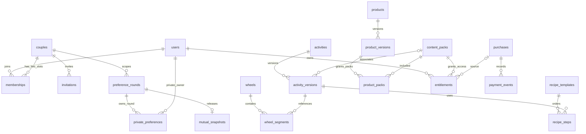

# D1 model and migration strategy

`migrations/0001_foundation.sql` is executable foundation SQL; no production database has been created. `seeds/local.sql` is a small idempotent public fixture set. Epoch timestamps are integer UTC seconds, external IDs opaque text, money integer minor units plus ISO currency, versions positive integers, JSON validated. Tables are SQLite STRICT with foreign keys, checks and explicit indexes. Currency format is basic length only; a server allowlist is still required.

## Implemented entity groups

| Group / tables                            | Ownership, constraints and access                                                                                                                                                                                                                                                                                                                             |
| ----------------------------------------- | ------------------------------------------------------------------------------------------------------------------------------------------------------------------------------------------------------------------------------------------------------------------------------------------------------------------------------------------------------------- |
| guest_sessions, guest_spins (M2, `0002`)  | Guest Discovery wheel state only. Opaque client nonce, 24h expiry with a `CHECK (expires_at > created_at)`, per-session spin rows keyed by the client idempotency key with a fixed-width request digest, wheel/activity version FKs, bounded purge and `ON DELETE CASCADE` from the session. Deliberately stores no heat, opt-in, exclusion or supply values. |
| users, adult_access                       | Independent identity mapping; unique optional auth subject, adult assertion bound to policy and expiry; self/admin-minimal access only                                                                                                                                                                                                                        |
| couples, memberships                      | Relationship entity, two slots (1/2), unique relationship-user and relationship-slot; indexed user/state; server must require two active independent users                                                                                                                                                                                                    |
| invitations                               | Hashed unique token, expiry, state/consume time, one pending per relationship; explicit acceptance required; no raw token storage                                                                                                                                                                                                                             |
| content_packs, categories                 | Catalog taxonomy/commerce associations; category opt-in requirement independent of heat                                                                                                                                                                                                                                                                       |
| activities, activity_versions             | Stable ID + composite version PK; category/pack FK, bounded heat/energy/experimentation, metadata JSON for tags/environment/supplies/prep/accessibility/safety/opt-ins/compatibility/phases; published/draft/withdrawn                                                                                                                                        |
| wheels, wheel_segments                    | Versioned wheels reference exact activity versions; positive bounded integer weight, one segment per stable activity per wheel version                                                                                                                                                                                                                        |
| recipe_templates, recipe_steps            | Versioned curated recipes, metadata JSON for theme/difficulty/time/boundaries; ordered phase steps reference catalog versions                                                                                                                                                                                                                                 |
| preference_rounds, private_preferences    | Fixed deck/revision per relationship; composite FKs tie owner to round/relationship membership; private padded encrypted envelope and key version, release authorization timestamp                                                                                                                                                                            |
| mutual_snapshots                          | One encrypted positive snapshot per round, relationship/consent epoch/revision/expiry; no plaintext match-count table                                                                                                                                                                                                                                         |
| generated_recipes, saved_experiences      | Encrypted versioned output, exactly one owner scope (individual or couple); per-user save links; every read revalidates scope and current eligibility                                                                                                                                                                                                         |
| products, product_versions, product_packs | Commercial SKU + immutable version-to-pack manifest; packs reference catalog rather than duplicate it                                                                                                                                                                                                                                                         |
| offers, prices                            | Offer interval and product version, price/currency/tax behavior/billing interval; separate from external processor IDs                                                                                                                                                                                                                                        |
| purchases, subscriptions                  | Processor reference uniqueness, actual charged amount/currency, buyer identity minimized on deletion; no card data                                                                                                                                                                                                                                            |
| entitlements                              | User/pack/source unique; free/ownership/subscription/trial/promotion/gift; active/suspended/revoked/refunded; start/end/share flag; time-limited kinds need an end                                                                                                                                                                                            |
| gift_redemptions                          | Unique hashed claim token and source purchase, recipient/state/expiry; capability only, no gift flow implemented                                                                                                                                                                                                                                              |
| refunds, payment_events                   | Refund audit/source amount; unique provider event, digest, durable processing state; neither webhook execution nor reconciliation implemented                                                                                                                                                                                                                 |
| audit_records                             | Actor/action/outcome/request ID/time only, no arbitrary sensitive metadata JSON                                                                                                                                                                                                                                                                               |

Auth identities/accounts, sessions, verification challenges and passkeys are **intentionally not hand-authored**. M1b generates tables from the reviewed pinned Better Auth configuration and maps its user IDs through `users.auth_subject`. This avoids pretending a conceptual auth table is a compatible framework implementation. Promotion and account deletion must handle both layers deliberately. Tags do not need an additional table until measured queries need a join index; mutual matches use an encrypted snapshot rather than plaintext per-activity rows.

## Schema limits and required service invariants

SQL foreign keys do not implement authorization. The scaffold exposes no private CRUD endpoints. Before adding them, scope all reads/writes by resolved user and active relationship, including preferences whose composite FK still references a revoked member. `users.auth_subject` is not an auth implementation. Unique slots restrict capacity, but activation still needs a transactional two-active-user check. Dissolved relationship IDs/slots are not reused; create a new relationship.

Preference payloads include exact activity versions, four-state responses and per-user category/role opt-ins. Encrypted generated output includes versioned items/alternatives; no sensitive activity IDs in relational analytics tables. Saved-experience links require self-owner/current-member authorization on insertion; FK existence alone is not sufficient. Snapshot round/couple correspondence must be checked by the service (the foundation schema does not enforce every cross-table invariant). Catalog metadata must validate with Zod before publication/consumption, even though SQL only checks JSON validity. Entitlement source/grant type/subscription/price correspondence requires commerce-service validation. Immutable product manifests are essential for refunding a particular source accurately.

Triggers advance relationship `consent_epoch` on private preference insert/update/delete and membership state update/delete. They provide invalidation, not permission. Match reads compare current epoch; a trigger does not purge cached rows or the user’s already displayed result. Publication/withdrawal advances the server’s catalog revision policy and invalidates affected output. A no-op edit can advance epoch; services should avoid accidental writes from polls.

## Atomic operations

- Invite accept: consume token conditional on pending/unexpired/unused, reject self, allocate slot 2, confirm both adult identities/members, activate relationship in one D1 batch. Pre-read checks need compare-and-set predicates; a zero-row consume cannot lead to an unconditional membership insert.
- Preferences/release: write own envelope/revision and trigger epoch; then conditionally create/update a snapshot with both release revisions/current relationship epoch. Edits revoke that release until both reconfirm.
- Shared spin/recipe: current primary-state eligibility followed by conditional claim at the same epoch/catalog/access state, check changes; idempotency keys and result claims are added in M2/M4 migrations when their route semantics are fixed.
- Dissolution/deletion: revoke access/session state and invalidate relationship first; purge encrypted shared records, save references and private envelopes; delete identity last after billing cancellation reconciliation.
- Fulfillment: authenticate event, insert unique event/transaction source, monotonic purchase transition and entitlement grants in one batch; duplicate event cannot create a duplicate grant.

[D1 batch semantics](https://developers.cloudflare.com/d1/worker-api/d1-database/) support transactional batches. There is no assumed interactive transaction spanning arbitrary Worker awaits. Use prepared statements/bindings and checked affected-row counts. Avoid read-then-write races across primary/replica calls. No selection endpoint is implemented yet, so conditional-claim persistence is designed, not claimed complete.

## Planned Chemistry Check entities (no migration yet)

Added 2026-11-20; [full specification](CHEMISTRY_CHECK.md). Existing migrations/seed/implemented tables above are unchanged. Model this as independent assessment scope, not a new kind of `couples`, membership or couple invitation. The names/columns below are a migration plan requiring review before implementation.

| Planned entity                             | Ownership, fields and constraints                                                                                                                                                                                                                                                                                                                                  |
| ------------------------------------------ | ------------------------------------------------------------------------------------------------------------------------------------------------------------------------------------------------------------------------------------------------------------------------------------------------------------------------------------------------------------------ |
| questions / question_versions              | Stable ID + immutable version, eight-dimension enum, answer schema/predicate semantics, sensitivity/opt-in flags, accessibility, publication state; no activity-eligibility semantics                                                                                                                                                                              |
| assessment_manifests                       | Unique manifest/version, question-bank family/release, depth restricted to 25/50/100, bounded ordered references to exact question versions and separately declared optional intimate extension; validate count/duplicate IDs/publication before use                                                                                                               |
| compatibility_assessments                  | Opaque ID, manifest/version, algorithm version, status, result_epoch, creation/acceptance/assessment/report deadlines; **no couple_id**, no auto-created relationship                                                                                                                                                                                              |
| compatibility_participants                 | Composite PK (assessment_id,user_id), unique (assessment_id,slot), slot 1/2, users FK; private state, current draft/submission revision, encrypted immutable submitted envelope/key version, reuse provenance, release approval bound to both submissions/manifest/algorithm/disclosure-mask digest/epoch/deadline; submission/disclosure data never a partner DTO |
| compatibility_invitations                  | Unique token hash, assessment/issuer FK, expiry/state/consumed_at, accepted-user binding; single pending invitation per assessment; distinct from existing couple-scoped invitations                                                                                                                                                                               |
| compatibility_results                      | Unique assessment + release epoch, approved-scope/algorithm/submission references, encrypted report/key version, access expiry; no plaintext answer, conflict count or per-person directional score; participant approvals are the read grants, not membership                                                                                                     |
| general_answer_templates                   | Owner user FK, immutable template revision, exact question versions/answer schema, encrypted general responses + acceptance/priority/rules, explicit save/reuse policy and renewal deadline; sensitive answers excluded initially; provenance tracks assessment copies for targeted withdrawal/deletion                                                            |
| assessment_credits (commercial phase only) | Purchaser + purchase/offer source, assessment-specific reservation, state available/reserved/consumed/returned/revoked, expiry; unique source-unit and single target reservation, one credit covers both participants in one assessment, no couple-membership lookup                                                                                               |

Manifest question references can initially be bounded validated JSON; use a join table with composite question-version foreign keys if needed for integrity/publication tooling, rather than blindly duplicating every activity table. Private response envelopes hold own answer, typed acceptable-partner set/range, weight, dealbreaker boolean, disclosure flags and unanswered/skipped/not-applicable state separately. Final migrations must distinguish immutable submissions from mutable drafts and preserve approval binding to exact snapshots; never silently update a released snapshot through a template reference.

Indexes/constraints: participant user/status lookup; unique two slots + assessment-user; inviter/expiry; one active assessment per **unordered user pair + question-bank family** across all depth/extension variants, enforced by a canonical pair key and partial unique constraint once both users bind; pair/family release-budget lookup and result/template expiry. A client cannot submit the canonical pair key, recipient authority or release epoch. Retain only minimal anti-abuse pair tombstones through the 30-day cooldown/recovery window, not private answers/history. Account-alias probing remains a residual risk.

Atomic accept: primary-state token check/conditional consume + independent slot bind + pair uniqueness, with zero couple/membership writes. Atomic submission/edit increments assessment epoch and clears both release approvals; any prior results become unreadable. Atomic release checks current two participants/submission revisions, matching approval digest/deadline and current epoch before inserting the result. Withdrawal, blocking, expiry and deletion advance epoch/revoke approvals before asynchronous purge. Guards must check affected rows against concurrent accept/release/withdraw; no pre-read + unconditional insert.

Defaults: 48h invitation, 14d accepted assessment, 30d released-result access, 90d owner-template renewal. Termination/deletion purges assessment envelopes/results within 24h; deleting either account terminates joint assessment access and derived records, without deleting the counterpart's independent template. Deleting a template can explicitly include dependent assessment copies; template-only deletion/reuse revocation does not silently rewrite already submitted snapshots. Financial source rows are minimized/retained separately as required. Backup aging/deletion-ledger replay follows [Privacy](PRIVACY.md). Any future downloadable shared report would be non-revocable, so defer exports initially.

Current `entitlements` and `canAccessPack` are **content-pack-specific**, not a completed service-credit mechanism. Plan an explicit product fulfillment discriminator (`content_library` versus `assessment_credit`) and source-backed credit service in a new reviewed migration at commercial implementation. Do not fake a service credit as a kink pack or borrow it through `activePartnerUserId`. Purchaser sponsorship pays for one assessment; both named participants have the same scoped report capability only after mutual release, and neither gains account or ongoing library access. Refund/payment events reuse the processor-independent fulfillment boundary while revoking the assessment's paid capability separately from consent.

## Migration workflow

Number SQL files sequentially and never edit an applied migration once shared beyond this foundation. Fresh-database tests apply all files in order. Wrangler tracks local migration history. Use expand → backfill in bounded batches → switch reads/writes → contract in separate releases. Review auth-generated SQL before importing it into ordered D1 migrations. No automatic migrations on HTTP startup. Do not use production as an experimental schema sandbox.

For now: `npm run db:migrate`, `npm run db:seed`, `npm run db:check`. Seed uses INSERT OR IGNORE for stable local fixture versions; changing published content means a new version and migration/seed update. Tests validate fixtures against the actual domain schema and verify idempotence, FKs, member capacity, epoch invalidation and event uniqueness. Local SQLite checks supplement actual Wrangler local D1, not replace it.

Indexes: memberships(user,state), invitations expiry/unique pending, catalog publication/category/heat, round relationship/state, snapshot relationship/epoch, generated expiry, purchases buyer/time, entitlement owner/pack/status/end, audit time. Inspect `rows_read/rows_written` and query plans before adding indexes; [D1 pricing](https://developers.cloudflare.com/d1/platform/pricing/) counts scanned rows and index writes. No full catalog scan per preference probe; batch load a bounded editorial deck.

## Retention, backups and growth

[Privacy](PRIVACY.md) contains the proposed TTL/deletion schedule. Cascades remove intimate records tied to deleted users/relationships; catalog/financial references usually RESTRICT to preserve immutable purchase/content integrity. User deletion SET NULL on buyer/subscription recipient metadata but must cancel billing first; purchases/events are retained minimally as legally required. Deleting a user alone does not implement relationship dissolution, encrypted shared-recipe purge, provider cancellation or backup erasure. Those are explicit service jobs/tests before launch.

Future recovery: use [D1 Time Travel](https://developers.cloudflare.com/d1/platform/limits/) (7-day free, 30-day paid), encrypted restricted export only when needed for a specific recovery objective, bounded retention and restore drill. Initial objectives: recover service within 24h, lose at most 24h of non-private operational records; validate achievable RPO/RTO with restore exercise rather than promising an SLA. Keep a minimal deletion/revocation ledger outside the database being restored, quarantining and replaying it before reopening access. Key backups have separate restricted handling. R2 is media only, not a relationship/entitlement backup authority.

Paid D1 has a 10 GB per-database limit; free is 500 MB per database, not its full 5 GB account allowance. Keep 90-day private TTLs and watch storage/index growth. At 100k MAU the cost model assumes 3 GB retained database footprint; a 10× larger history would require a retention redesign or partitioning, not silently exceeding D1 limits. Do not pre-shard a database solely because scale might arrive.
