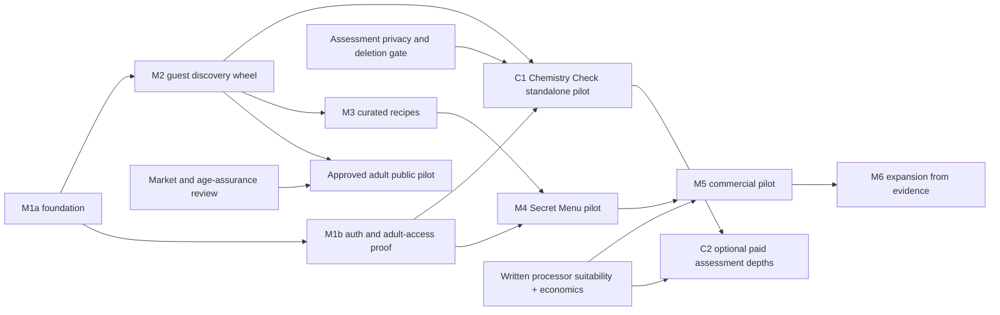

# Roadmap and implementation backlog

## Current delivery

**M2 — first playable Wheel of Misfortune (guest Discovery Mode): implemented and released
2026-11-20.** A curated, versioned, non-explicit 44-entry catalog (plus 6 unreviewed heat-3
drafts that can never be served), server-side eligibility filtering, cryptographically
unbiased selection with a readable 8-wedge shortlist, heat/experimentation/energy/time/
setting/supplies ceilings, category opt-ins and hard exclusions, a mobile-first retro-casino
wheel with reduced-motion and optional sound, 24h guest sessions that store no boundaries,
and 35 unit/integration plus 16 browser checks. Contract, retention and limitations are in
[Wheel](WHEEL.md); release evidence is in [Validation](VALIDATION.md) and the
[launch report](LAUNCH_REPORT.md).

Acceptance status against the M2 table:

| Item                     | Result                                                                                                                                                              |
| ------------------------ | ------------------------------------------------------------------------------------------------------------------------------------------------------------------- |
| Catalog pipeline         | 50 immutable versions compiled from a typed editorial source; build/read validation; drafts excluded; 3 previews unchanged                                          |
| Wheel configuration      | Heat, experimentation, energy, time, setting, supplies, opt-ins, exclusions and repeat policy are independent; least-permissive defaults; no default YES            |
| Server selection         | Bounded strict input, deterministic eligibility, crypto-random authoritative result before animation, uniform and weighted tests                                    |
| Guest session            | In-memory nonce + 24h D1 TTL, explicit reset, bounded budget, no intimate history, no cookies or browser storage                                                    |
| Result claim/idempotency | Reviewed migration `0002`; repeats return the same result; changed digests and foreign sessions rejected; withdrawn results invalidated; no empty-pool relaxation   |
| Wheel UI                 | Marquee + labelled SVG wheel, readable ordered-list alternative, optional muted sound, reduced-motion instant result, keyboard/focus handling, passing/exit obvious |
| Safety/mode copy         | Result DTO carries `discovery-prompt-not-consent`; permanent copy distinguishes idea from approval; full metadata, stop/change affordances; no timers or rewards    |
| Tests                    | Constraint boundary, weighted/uniform property, invalid/missing opt-ins, withdrawal, concurrent duplicates, mobile/keyboard/axe/reduced-motion                      |
| Adult pilot              | **Outstanding**: local moderated adult usability testing, the 90% comprehension target and median first-result measurement still need real participants             |

**Partially satisfied, and deliberately not claimed:** "leaving 3 current fixtures remain public
previews" holds (exactly three `public_preview` rows), but professional review of the 44
published entries is an editorial lint, not a certified review; heat 3 stays unpublished until
the content/market gate is satisfied. Public access for a real adult pilot also still depends on
the market review listed in "Decisions still needed".

**M1a — Local architecture and foundation: implemented.** Product/commercial research, threat model, brand/UX specification, one Worker shell, three safe public fixtures, SQL migrations, consent/entitlement/selection primitives, fail-closed integration boundaries and CI definition. [Validation](VALIDATION.md) reports executed checks. At the original foundation checkpoint there was no playable wheel, live authentication, real private-data storage, payment processing, R2 bucket, public launch or production resource. The public-release update below supersedes its deployment status.

Approval for this foundation does not approve the entire application, billable provisioning or deployment. The next milestone below is proposed work, not implied authorization to execute it now.

**Superseding authorization, 2026-11-20:** the user has now authorized committing/pushing, required Cloudflare resources, public production deployment, domain routing, CFLab, Search Console setup and automated releases. This authorizes the safe public shell, not the entire product or unexpected paid subscriptions. Release integration adds nine useful public pages, social art/metadata, canonical/sitemap/robots, production configuration and CI/CD. Auth, real games/recipes, private matching/assessments and purchases remain planned. [Launch report](LAUNCH_REPORT.md) records which operational postconditions are actually verified and which external prerequisites remain.

## Recommended order

Reorder the original milestones slightly: prove identity/age assurance before collecting partner preferences; build a guest wheel early to validate delight before a complex matching system; start processor research now but defer integration and paid commitments until written suitability. Do not let an approved free public pilot imply approval for new paid services. Recipes can use guest discovery mode without waiting for mutual matching. Shared recommendations depend on the full M4 release gate.

Chemistry Check was added to planning on **2026-11-20**. Recommend launching **after the first playable Wheel**, with non-sensitive concept tests alongside M2 and a separate C1 pilot once authentication and assessment privacy controls pass. It may run alongside M3 development and does **not** depend on M4 couple membership. C1 and M4 can reuse reviewed privacy primitives without treating assessment participation as a relationship. Neither the diagram nor this recommendation authorizes implementation or deployment.

## M1b — Authentication and adult-access proof

Tasks:

1. Recheck current Better Auth advisories and pin supported stable core/plugin/adapter versions; generate framework schema in a reviewed new migration.
2. Implement D1 mapping behind IdentityService; secure host-only cookies, primary-state session revocation and explicit idle/absolute expiration.
3. Prove single-use email flow/scanner-safe deliberate continuation, provider suitability and local test transport before any external sends. Add optional passkeys with explicit RP/origin config and multiple credentials.
4. Implement session/device management, fresh-auth actions, recovery, account-linking policy, explicit guest import and deletion service boundaries.
5. Prepare counsel-readable catalog examples and jurisdiction classification matrix; decide initial supported market subset and whether a suitable age-assurance provider is needed. Quote checks/minimums and recalculate costs before provisioning.
6. Test CSRF, fixation, token replay/concurrent use, invalid origins, recovery races, revoked sessions, guest migration and auth log redaction in workerd/local D1. No production secrets needed for a local proof.

Exit: no auth “TODO” on private routes, documented recovery limits, actual supported auth schema, per-route abuse budgets, adult-access requirement enforcement design and local integration evidence. Public launch is still a separate approval/legal gate.

## M2 — The first playable Wheel of Misfortune (recommended next product milestone)

This is a bounded implementation proposal: one polished **guest Discovery Mode** wheel, not all wheel types or couples matching.

| Backlog item             | Acceptance criterion                                                                                                                                                                             |
| ------------------------ | ------------------------------------------------------------------------------------------------------------------------------------------------------------------------------------------------ |
| Catalog pipeline         | 40–60 editorially reviewed topics in immutable versions; all validate; unsafe/unreviewed drafts excluded; 3 current fixtures remain public previews                                              |
| Wheel configuration      | Heat, experimentation, category opt-ins, environment/supplies, exclusions and repeat policy are separate; sensible mobile defaults and no default YES                                            |
| Server selection         | Bounded input validation, deterministic eligibility, unbiased authoritative result before animation, no client random authority; uniform first, positive-weight variation supported by tests     |
| Guest session            | Default transient behavior; if server history is needed, opaque 24h TTL and explicit reset; no intimate analytics history                                                                        |
| Result claim/idempotency | New migration only when route contract is fixed; repeats return same valid request result; changed request digest rejected; no empty-pool boundary relaxation                                    |
| Wheel UI                 | Recognizable marquee, readable segment/list alternative, optional muted sound, reduced-motion instant result, keyboard/focus handling, passing/exit obvious                                      |
| Safety/mode copy         | Discovery prompt visibly distinguished from action approval; full result metadata and stop/change affordance; no pressure timer or completion rewards                                            |
| Tests                    | Constraint boundary/property tests, weighted/random boundary tests, invalid/missing category opt-ins, catalog withdrawal, concurrent duplicate request, mobile keyboard/axe/reduced-motion tests |
| Adult pilot              | Local moderated adult usability tests first; 90% mode understanding target and median first result <60s; public access only after market review                                                  |

Exit: a delightful actually playable wheel with validated server filtering, clear limitations and user feedback. No invitations, billing, custom UGC, explicit artwork or AI necessary.

## M3 — Date Night Machine and Romance Cookbook

Create 6–10 reviewed phase templates referencing catalog versions. Implement context schema, supplies/prep union, summed duration, phase compatibility and bounded composition. Alternatives revalidate identically. Add guest recipe view and a small optional private save flow only if M1b complete; otherwise transient output. Record explicit bounds for quickie/all-evening and accessibility options. Test incompatible pairs, no-plan cases, withdrawn versions, insufficient prep/time and category opt-in intersections. Exit: coherent editable evenings, no unauthorized substitutions or AI-dependent eligibility.

## C1 — Chemistry Check: standalone pre-date pilot (planned)

The [module specification](CHEMISTRY_CHECK.md) defines the 25/50/100-question product, eight dimensions, optional intimate expansion and independent invitation scope. Start the pilot with the free 25-question core; offer reviewed 50/100 depths after completion/disclosure testing. C1 is **after M2 and M1b**, and requires an assessment-specific privacy/crypto/deletion gate before real submissions. It can ship before couples features if those independent controls are ready.

| Backlog                | Acceptance criterion                                                                                                                                                                            |
| ---------------------- | ----------------------------------------------------------------------------------------------------------------------------------------------------------------------------------------------- |
| Question catalog/decks | Versioned 25/50/100 manifests cover all eight dimensions without mandatory intimate answers; explicit opt-in before any sensitive display/reuse; original reviewed content                      |
| Response semantics     | Own answer, acceptable-partner predicate, importance, independent hard rule, disclosure policy and unanswered/skipped/not-applicable states captured distinctly                                 |
| Acceptance scoring     | Different answers can align; same answers can be unacceptable; directional weighted acceptance combines conservatively; no zero/unknown denominator shortcuts                                   |
| Hard checks            | Separate conflict/none-detected-in-scope/insufficient state; unknown hard responses remain unknown; private-only rules affect no shared output or availability branch                           |
| Independent invitation | Two authenticated adults with **no couple records** can accept/submit/release; accepting creates no couple, session merge, answer disclosure or ongoing account rights                          |
| Release and lifecycle  | Both approve exact manifest/submissions/algorithm/disclosure/deadline; atomic epoch checks; edit/withdrawal/expiry/account deletion revoke future reads; no private counterpart progress        |
| Reuse and probing      | Separate save and per-assessment import consent; immutable versions/provenance; no sexual reuse initially; one active pair/family and cross-depth release budget; no arbitrary probe/delta APIs |
| Shared report          | Category summaries only for authorized sufficient coverage; sexual dimension defaults unshared; no raw sexual answers, dealbreaker identity/count or predictive percentage                      |
| Operational privacy    | Block/refusal not paywalled; encrypted storage review, bounded purge/retention, restore/revocation drill, rate controls and cross-account/race tests                                            |
| Validation             | ≥90% disclosure/consent comprehension hypothesis in moderated adult tests; pilot measures accepted invitations→two independent submissions→mutual release, never score-based marketing          |

Why after the Wheel: the Wheel delivers a distinctive entertaining result with one visitor; Chemistry Check needs two accounts, acceptance, answers and informed mutual release, plus more demanding abuse/inference controls. Pre-date search/invitations could widen acquisition, but trust/friction and occasional use make revenue uncertain. Non-sensitive concept tests can validate interest without storing private profiles. No psychometric or relationship-outcome claim is earned by these tests.

## C2 — Optional paid Chemistry Check depths (conditional)

After free C1 evidence and written processor suitability, test $4.99 versus $9.99 for one sponsored two-person 50/100-depth assessment. Add the explicit service-credit/product-fulfillment model; do not reuse a couple-dependent pack check. Both participants may refuse/revoke, and a purchase buys no release/answer access. Define unused-credit returns/refunds, report expiry, chargeback revocation and declined/abandoned invitation handling before charging. A paid depth can be selected jointly before first release; after a free report the same-pair release cooldown still applies, so no instant paid rerun or checkout promising an unavailable report. No recurring billing initially. This is a separate experiment from M5 content packs; reorder commercial priority only if free-pilot evidence and actual underwriting favor it. No live payments are authorized by this plan.

## M4 — Couples and Secret Menu pilot

Implement independent invitations/acceptance, membership revocation/dissolution, fixed decks, encrypted private envelopes, explicit positive disclosure by both and shared YES/YES snapshots. Add consent-epoch/catalog/access revalidation to wheel/recipes/saves. No arbitrary custom probes, result-count endpoint, partner progress, photo/chat/sexual tracker or more-than-two-person shared play.

Exit requires independent privacy review, malicious-partner exercise, cross-user authorization matrix, concurrent preference edit/spin/leave tests, ciphertext/AAD/key-rotation review, expiry/purge jobs, deletion and quarantined restore drill. Adult testers must understand what positive sharing reveals. A “not E2EE” notice, retention defaults and support incident process must be published before real private records are accepted.

## M5 — Commercial pilot

Select only after explicit user approval and written merchant suitability for actual CheapSeggs content. Resolve entity/markets/MCC, full fee/reserve quote, tax/seller role, cancellation/refund obligations and checkout data disclosure. Test one collection/bundle experiment with hosted checkout and source-based individual ownership plus active-partner borrowing.

Add provider adapter, authenticated event persistence/reconciliation, idempotent atomic grants, out-of-order/refund/chargeback handling, server asset checks and clear pending/fulfilled/refunded states. Do not insert an upsell into active play. Exit: sandbox tests and refund/cancel/reconcile exercise, then a small separately approved live pilot; measure 30 real purchases and interview users before expanding offers. No automatic subscription by default.

## M6 — Expansion based on evidence

Add wheel themes, curated packs, seasonal/anniversary/hotel editions, custom wheel tools, favorites/collections, gifts or printables one at a time when usage/economics justify them. Seven-day challenges are optional play, not pressure streaks. White-label/getaway partnerships need explicit business approval. AI may restyle already eligible plans only after privacy/provider/content-policy/cost review; never send a partner’s raw answers to a model or let it add unapproved activity IDs.

## Decisions still needed

Merchant entity/domicile; supported jurisdictions and actual catalog classification; age-assurance provider/privacy/cost; email transport suitability; supported stable auth version and exact configuration; specialist content reviewer; crypto/key-management review; target retention/legal record periods; actual offer price and processor quote; public launch scope and production configuration; licensing/public share image; business/IP license for the public repository. No assumption here selects a provider or accepts a contract on the founder’s behalf.

## Deliberately deferred implementation

Chemistry Check is entirely deferred implementation: no question-bank tables, scoring code, assessment UI/routes, reusable general-answer templates, assessment grants or service credits have been added to the executable foundation. Its design is documented so future work does not accidentally inherit couple-membership or activity-consent semantics.

Full auth/recovery, partner APIs, encryption routines/keys, automatic deletion jobs, distributed rate limits, real adult catalog, playable wheel, full recipe engine, production R2/media delivery, user-generated content/chat, analytics collection, production monitoring/backup operations, checkout/webhooks/tax, subscriptions/gifts and deployment. Schema/interfaces support later work; they do not make these features operational. Implementation requires review and tests appropriate to each milestone.
